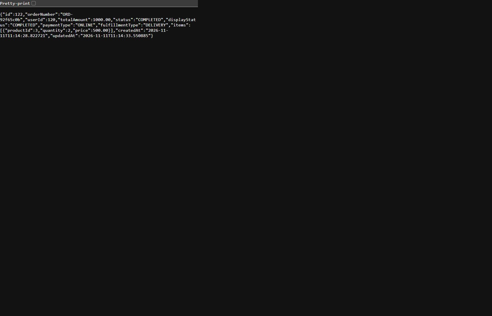
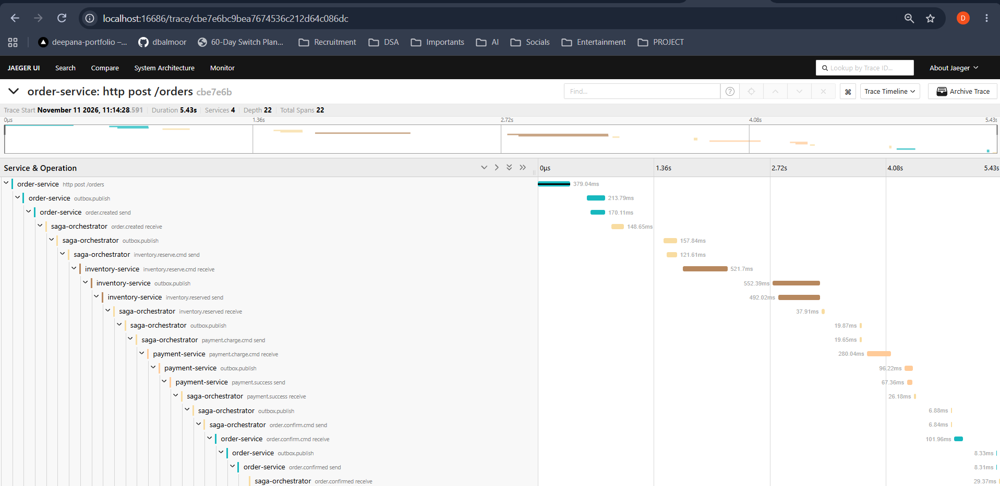

# End-to-end success verification: order 122

**Date:** 2026-11-11  
**Order:** `122` (`ORD-92f65c0b`)  
**Saga:** `59fa691a-cb49-477f-9600-b40c93ea7f2b`  
**Result:** Completed successfully

## Request

```json
{
  "userId": 120,
  "paymentType": "ONLINE",
  "fulfillmentType": "DELIVERY",
  "items": [
    {
      "productId": 3,
      "quantity": 2,
      "price": 500
    }
  ]
}
```

The order total was `1000.00`. The order API initially returned `CREATED`
while the asynchronous saga ran; `GET /orders/122` subsequently returned
`COMPLETED`.

## Verified outcome

- Order `122` is `COMPLETED` (`displayStatus: COMPLETED`).
- Saga `59fa691a-cb49-477f-9600-b40c93ea7f2b` is `COMPLETED` at step
  `COMPLETED`.
- Saga step history shows `order.created` → `inventory.reserved` →
  `payment.success` → `order.confirm.cmd` → `order.confirmed`.
- The payment database contains one `SUCCESS` payment for order `122`,
  order number `ORD-92f65c0b`, amount `1000.00`.
- The inventory database contains a `RESERVE` event marker for order `122`
  and this saga. The current product-3 aggregate is 97 available and 3
  reserved; that aggregate includes reservations beyond this order and is
  not presented as an order-specific delta.
- Jaeger trace `cbe7e6bc9bea7674536c212d64c086dc` contains 22 spans across
  `order-service`, `saga-orchestrator`, `inventory-service`, and
  `payment-service`, including HTTP, Kafka send/receive, and outbox publish
  spans. Jaeger displayed a total trace duration of 5.43 seconds.

## Screenshots

**Completed order API response**



**Jaeger trace**



## Verification context

This is evidence from a manual local end-to-end order and read-only inspection
of the order, saga, payment, inventory, and Jaeger data. It is not a new
automated end-to-end test. The separate full Maven verification completed on
2026-11-10 with `mvn -B clean verify` on Java 17: BUILD SUCCESS, 59 tests,
0 failures.
