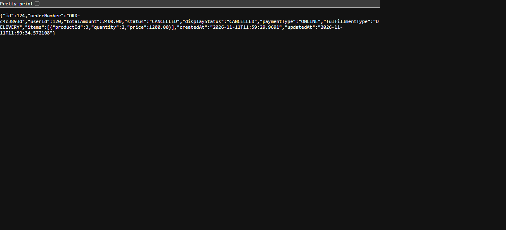
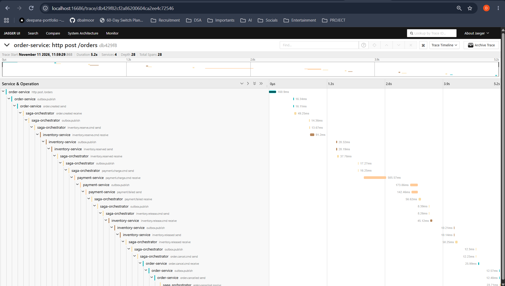

# Payment failure and compensation verification: order 124

**Date:** 2026-11-11  
**Order:** `124` (`ORD-c4c3893d`)  
**Saga:** `0c1aec02-2ac4-4bf9-b039-b919a4e8a840`  
**Result:** Cancelled after payment failure and inventory compensation

## Request

```json
{
  "userId": 120,
  "paymentType": "ONLINE",
  "fulfillmentType": "DELIVERY",
  "items": [
    {
      "productId": 3,
      "quantity": 2,
      "price": 1200
    }
  ]
}
```

The order total was `2400.00`. The payment service was configured to fail
payments at or above `1000.00`.

## Verified outcome

- `GET /orders/124` returned `CANCELLED` (`displayStatus: CANCELLED`).
- The payment record is `FAILED`; the saga is `CANCELLED`.
- Inventory markers show both `RESERVE` and `RELEASED` for this order and saga.
- Product 3's 2-unit reservation was released: available/reserved returned to
  **95/5 before** → **93/7 while reserved** → **95/5 after**. The final
  aggregate includes other orders; no other inventory event was recorded
  during this order's reserve/release interval.
- Saga history shows `order.created` → `inventory.reserved` →
  `payment.failed` → `inventory.release.cmd` → `inventory.released` →
  `order.cancel.cmd` → `order.cancelled`.
- Jaeger trace
  `db429f82cf2a86200604ca2ee4c72546` contains 28 spans across four services.
  The trace duration displayed was 5.2 seconds; it includes payment failure,
  inventory release, and order cancellation.
- Process-lifetime Prometheus counters were `saga_started_total=2`,
  `saga_completed_total=1`, and `saga_cancelled_total=1` when inspected.
  These values reset on service restart and are not presented as deltas.

## Screenshots

**Cancelled order API response**



**Jaeger trace**



The live trace is also available at
http://localhost:16686/trace/db429f82cf2a86200604ca2ee4c72546 while the local
Jaeger instance retains it.

## Verification context

This is manual local end-to-end evidence and read-only inspection of the order,
saga, payment, inventory, Prometheus, and Jaeger data; it is not an automated
end-to-end test. The last full Maven verification completed on 2026-11-11 with
`mvn -B verify` on Java 17: BUILD SUCCESS, 59 tests, 0 failures.
